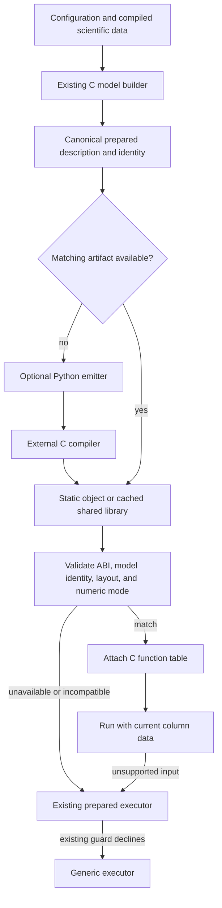

# REAPER implementation plan for TurboTUV

Status: current session goal achieved. The user clarified on 2026-10-23 that
one primary case above 2x completes this session. TS1/GCC reaches
2.030x, with a 95% lower bound of 2.025x. R0 through R6 and the
spectral follow-up are validated. Work on TUV/GCC, TUV/Clang and TS1/Clang
is deferred to follow-on sessions. Cross-architecture execution is not yet
demonstrated. See `docs/REAPER_RESULTS.md` and `docs/REAPER_HANDOFF.md`.
Prepared 2026-10-22 on branch `reaper`, based on `main` at
`9e149851af5bc48fc7ce64b5fbe50c6959ff2d51`.

## Objective and acceptance contract

Achieve **at least another 2x speedup over the current prepared execution on
`main` in at least one primary case**, with no upper limit on the improvement.
The user clarified this session completion boundary on 2026-10-23; extending
the result to the other three cases is follow-on work. Agreement within
**double-precision roundoff is acceptable**; bit identity is useful for
diagnosis but is not the new optimization target. Implement the numerical
library and any emitted kernels in **portable C11 using standard libm**.

The denominator is the prepared implementation at the revision above, not the
older `baseline` branch, generic execution, or original Fortran TUV-x. Those
remain correctness references and secondary performance comparisons. The
existing 4.3–7.6x improvement over `baseline` does not count toward this goal.

Use these initial operating points, matching the current performance study:

| Dimension | Primary requirement |
| --- | --- |
| Workload | Complete columns for `examples/tuv_5_4.json` and `examples/ts1_tsmlt.json`, with the benchmark's changing temperature, air, O2, O3, zenith, and radiation scale |
| Execution | One thread, existing single-column host API, all currently returned fields and rates |
| Toolchains | GCC and Clang, each compared with its own frozen-main build on the same machine |
| Numerical result | Per-field roundoff gates below, all existing scientific and error-handling requirements |
| Performance result | At least one of the four configuration/compiler combinations has a 95% lower speedup bound of at least 2.0x for this session; report all four, and retain the others as follow-on targets |
| Portability | Standard C11 source and libm; no required assembly, ISA intrinsics, GPU, vendor math package, or embedded compiler |

A robust 2x gain on one configuration/compiler completes the clarified session
goal. It remains a scoped result; the other three cases are follow-on targets.
Batched columns and multiple threads are separate throughput experiments; they must not silently replace the
single-column comparison. Hardware-specific compiler flags, if evaluated,
must be applied to both sides of an additional comparison and must not become
a requirement for building the library.

If 2x cannot be achieved, produce a reproducible, quantitative conclusion
limited to the tested hardware, numerical contract, and optimization space.
An unsuccessful search alone does not prove impossibility. If the evidence
cannot establish a bound, report **not achieved; feasibility unresolved**,
rather than claiming the objective has been disproved.

## What the reference solution contributes

The reviewed sources are TurboMICM `main` at
`d115f88751b03dfe3ff6abafee7d12db32f76383` and its wiki at
`3ab94edc0950f94992339fb8fc0f31163d0eae1f`. Both local heads matched their
remote heads when inspected. The wiki defines REAPER as **Run-time: Emit,
Assemble, Plug in, Execute, Reuse**: derive C kernels from a loaded model,
compile once, check their identity before attachment, and reuse the compiled
artifact. Fable's reference entry implements the generation and attachment
ideas at build time; the wiki describes moving preparation to host startup.
It is not evidence that the `fable/` library already implements that complete
runtime cache. [F1, F2]

| Fable mechanism | Transfer to TurboTUV |
| --- | --- |
| Straight-line kernels with literal indices | Emit rate terms, spectral interpolation operations, and selected radiation loops from the actual prepared model |
| Gather each output's terms; interleave independent sums | Integrate several rates or levels together; remove term interpretation and overlap independent dependency chains |
| Vector-ordered blocks and groups | Tune levels, wavelengths, and optionally columns as independent lanes; distinguish vector width from cache-block size |
| Target-by-target panel work and pass fusion | Reduce intermediate traffic and combine work with identical inputs; sparse LU itself is not a replacement for TUV's transfer solvers |
| Fingerprinted function tables | Attach only kernels matching the model, layout, numerical mode, and ABI; retain prepared and generic fallbacks |
| Exact and fast variants | Keep the current exact paths as controls; evaluate roundoff-safe reassociation, FMA, and reciprocal reuse in the new path |
| Measure and reject attractive but slower variants | Record whole-column timings, code size, spills, cache behavior, and rejected experiments, not just operation counts |

Fable's results show that larger generated functions, wider blocks, and fewer
instructions can make execution slower. The Derecho work also shows that
compiler vectorization decisions can dominate a nominally identical source
loop. Use those as experimental lessons, not speedup predictions for TUV.
Its OpenMP pragmas, native flags, and FMA settings are not portable-C
requirements for this implementation. [F3, F4, F5]

One source discrepancy matters: `fable/include/tmc.h` describes a kernel
mismatch falling back, but `fable/src/builder.c:1038` rejects attached kernels
with a mismatched width/fingerprint. Define and test TurboTUV's behavior
explicitly instead of copying that ambiguity. [F6]

## Starting point and available headroom

TurboTUV already implements much of the first optimization layer:

| Existing implementation | Work still performed during a column |
| --- | --- |
| `src/spectrum_plan.c`: constants, varying wavelengths, hoisted expressions, shared evaluations | Formula dispatch, variable spectra, scalar transcendental calls, parameterized interpolation |
| `src/model_plan.c`: precomputed rate terms and zero-term omission | Pointer loads and term-kind branches; 16-level tiles; repeated traversals for separate rates |
| `src/radiation_block.c`: 16 wavelengths in lock step | Radiator mixing, slant sums, coefficients, transfer solves, scalar `exp`, and output passes |
| `src/model_plan.c` and `src/oxygen.c`: O2 work shared among reactions | Separate optics and cross-section calls when both are needed; temporary allocation inside each call |
| `src/model_run.c`: prepared-to-generic fallback | Input guards and the full generic correctness path |

Do not count these existing optimizations again. The performance document
previously judged generated code unlikely to save much for dense TUV arrays;
this plan tests that judgment against the remaining indirect rate terms and
fixed interpolation structure. [T1]

Historical Clang stage timings from `docs/PERFORMANCE.md`, in microseconds
per column, provide an initial cost model:

| Stage | tuv_5_4 | ts1_tsmlt |
| --- | ---: | ---: |
| Delta-Eddington transfer and mixing | 409 | 283 |
| Varying reaction spectra | 250 | 442 |
| Rate integrals | 263 | 103 |
| O2 band optics and cross sections | 77 | 77 |
| Geometry, gas optics, actinic flux | 38 | 29 |
| Sum of these instrumented stages | 1,037 | 934 |
| Half that sum | 518.5 | 467.0 |

These are previous measurements, not fresh timings. Their stage sums are not
identical to the separate uninstrumented benchmark totals. They also omit
some host-update overhead relevant to the primary benchmark. Re-measure both
compiler families before making decisions from these fractions.

For a change confined to one stage, eliminating that entire stage would give
the following optimistic ceilings, calculated as `total / (total - stage)`:

| Only stage changed | tuv_5_4 ceiling | ts1_tsmlt ceiling |
| --- | ---: | ---: |
| Transfer and mixing | 1.65x | 1.43x |
| Varying spectra | 1.32x | 1.90x |
| Rate integrals | 1.34x | 1.12x |

No single-stage campaign is sufficient on these measurements. Even halving
all three large stages gives only about 1.8x if the rest is unchanged.
Improving those three by 2.5x would give about 2.14x on these stage sums;
that is a budget illustration, not a prediction. Roundoff-level arithmetic
changes enlarge the available search space but do not establish feasibility.

## Numerical and portability rules

Keep the current generic and exact prepared paths available as independent
controls. Initially expose the new path through an additional execution
selection, provisionally `TT_EXECUTION_REAPER`, without changing the numeric
values or the bit-identity promise of the existing enum values. An exact
generated variant is useful for separating code-generation bugs from
roundoff effects. Selection of the new default, if warranted by the final
results, must be explicit in the API documentation and release notes.

Before tuning, add numerical comparisons for the new path with limits derived
from the existing tests, not from whatever the fastest candidate produces:

| Quantity | Initial gate |
| --- | --- |
| Spectrum, temperature, O2, and standalone rate kernels | Existing per-test normalization and 32 relative epsilon units where those tests currently use 32 |
| Six complete-model radiation fields | Existing `tests/test_model.c` normalization: `abs(a-b) / (epsilon * max(abs(a), abs(b), 1)) <= 64` |
| Complete-model photolysis, heating, dose | Existing 64-epsilon relative gate, with no unit-sized absolute tolerance that would hide small rates |
| Actinic flux and spectral irradiance | 64-epsilon relative comparison; inspect cancellation cases using the known incident-source scale before declaring any exception |
| Physical zeros, invalid inputs, and metadata | Preserve structural zeros, finite/nonnegative requirements, labels, dimensions, statuses, and error behavior; roundoff permission is not permission to discard these |

Use `DBL_EPSILON`, existing underflow conventions, and explicit zero handling.
Record maximum absolute, relative, epsilon-scaled, and ULP differences with
their field, configuration, column, wavelength, and level. ULP counts are
diagnostic near zero, not a substitute for the physical normalization.
Compare to frozen prepared C and generic C within each toolchain, and directly
to the existing Fortran references where available. A small C-to-C difference
must not conceal an accumulated failure of the Fortran gate. Existing
scientific limits are not to be raised merely to accommodate an optimization.

Allowed experiments include multiple accumulators, changed reduction trees,
explicit standard-C `fma`, reuse of `1/x`, and algebraic interpolation weights,
provided they pass these gates. Preserve a selectable ordered-arithmetic
variant to explain discrepancies. Keep NaN/Inf checks and exceptional-input
fallback valid: do not enable blanket `-ffast-math`, finite-only assumptions,
flush-to-zero, reduced precision, or coarse spectral/vertical grids.

Use ordinary C loops and let the compiler vectorize independent lanes. Any
compiler-specific vectorization hint is an optional, guarded experiment with
an equivalent plain-C path; no OpenMP runtime is required. Standard `fma`
may be a library call on some targets, so its speed must be measured. Vendor
vector `exp`/`log`/`pow`, ISA intrinsics, and assembly are outside the required
portable implementation. If libm becomes the limiting cost, investigate
portable reuse and batching first; any new portable math approximation would
need a separately justified roundoff error bound and exhaustive boundary
validation, not just a fit on the two timing inputs.

Python may emit C during preparation, as in Fable. It is not embedded in the
library and is not required when executing an already prepared artifact.
Runtime compilation/loading is optional platform integration. A static
ahead-of-time C path and the ordinary C11/libm build must always work without
Python, a runtime compiler, dynamic loading, or an external data service.

## Proposed implementation sequence

### R0 — Freeze the control and make the measurements reproducible

1. Build the pinned `main` revision in an isolated source/build directory with
   both real GCC and Clang; record compiler paths/versions, flags, CPU/OS,
   source and binary hashes, input hashes, and floating-point mode. Do not
   assume a command named `gcc` is GNU GCC on macOS.
2. Preserve the actual CTest inventory and run the existing C, prepared,
   host-update, and configured Fortran reference suites. Record the original
   reference revision `ebe5006` and the data-manifest hash.
3. Add benchmark-only stage timers and counters around host updates, geometry,
   gas optics, both O2 uses, transfer sub-stages, spectral evaluation by type,
   and the three integration families. Measure timer overhead against an
   uninstrumented build. Use samples and compiler reports to split arithmetic,
   libm, memory traffic, allocation, and dispatch costs.
4. Count actual new-kernel calls, prepared fallbacks, and generic fallbacks.
   The current benchmark's `execution=prepared` reports selection, not proof
   that each column stayed on that path. A generated-kernel claim must show
   that the generated kernels actually ran.
5. Implement the roundoff comparator before relaxed arithmetic. The current
   `tools/bench_compare.py` checks hash equality, and `--allow-differences`
   only disables that check. It does not perform a numerical comparison.
   Add a full-output comparison using the benchmark's `--output` data plus
   field/shape/input metadata; gate the exact binary used for timing.

Deliverables: `docs/evidence/reaper/baseline/`, a field-aware comparison tool,
reproducible profiling options, and a new baseline table. Do not make a
speedup claim from instrumented timings alone.

### R1 — Reduce known overhead in portable C

These candidates are useful even if generated kernels are ultimately rejected.
Measure them separately and together, retaining the best validated combination.

* **Rate-loop layout.** Sweep level tiles `1, 2, 4, 8, 16, 32` and a full-level
  loop. The prior Clang experiment reduced the tuv_5_4 rate stage from about
  261 to 132 microseconds by removing 16-level tiling; GCC behaved differently.
  Test independent sums interleaved over levels/rates and then split wavelength
  sums under the new roundoff gate. Measure spills and generated code rather
  than assuming a tile is a hardware vector width.
* **Fixed interpolation structure.** In `parameterized_prepare`, precompute
  the overlap list currently rediscovered by `conserve` for every level.
  First replay the original arithmetic using literal segment indices and
  precomputed coordinate differences. Then test linear-weight accumulation,
  fused operations, and batched evaluation across levels. Preserve range
  selection, padding, overhang conventions, and all four parameterizations.
* **Shared O2 work.** When both an O2 radiator and O2 reactions need the same
  column, call `tt_oxygen_optics` once with both output pointers. The function
  already supports this. Move reusable `20 * nz` workspace into model-owned
  storage through an internal workspace-taking helper; retain the public
  wrapper. Hoist repeated per-level logarithms where their operands match.
  Preserve depth-only, cross-only, and neither-needed cases and failure order.
* **Memory passes.** Profile gas-optics writes, flux formation, finiteness
  checks, and rate inputs for legal fusion. Continue producing every public
  radiation field and radiator view. Do not eliminate output work simply
  because the benchmark does not read an intermediate.

Touch points: `src/model_plan.c`, `src/spectrum_plan.c`, `src/oxygen.c`, and
focused additions to the existing model/spectrum/O2 tests.

### R2 — Emit rate kernels from the existing model plans

Start with ahead-of-time compilation to test the performance idea before
building a runtime cache.

1. Export a versioned internal description from the authoritative C model
   plan: dimensions, evaluation slots, ordered terms, term kinds, constant
   factors, energy factors, scales, and output offsets. Use offsets/IDs, not
   process pointers. Encode precomputed doubles without changing their bits,
   for example hexadecimal C literals.
2. Write `tools/reaper/generate.py` to emit standard C11 kernels. Do not add a
   second Python implementation of TUV's configuration interpretation or
   spectrum classification. The C builder remains the source of truth.
3. Emit separate photolysis, heating, and dose kernels with literal offsets
   and known term kinds, removing the per-term switch and pointer chasing.
   Keep an ordered variant; separately test 2/4/8 accumulators, interleaved
   outputs, reusable products, and `fma` under the roundoff contract.
4. Sweep bounded generated-function sizes and level tiles. Start with term
   budgets of `32, 64, 128, 256` per function and measure code size, compile
   time, instruction-cache pressure, and whole-column time. Retain loops
   where full expansion produces excessive code.
5. Test arbitrary model configurations, not only the two timing cases.
   Unsupported kernels use the existing prepared executor. Retain generated
   code only if it contributes a repeatable gain alone or in a measured
   combination.

Deliverables: plan export, deterministic emitter, statically linked prototype,
ordered/roundoff comparisons, and generated-versus-interpreted timings.

### R3 — Specialize spectra and radiative transfer

Choose priorities from the fresh profiles; the historical ts1_tsmlt spectrum
cost makes this as important as rate integration.

| Candidate | Implementation experiment | Main risk to measure |
| --- | --- | --- |
| Parameterized spectra | Emit overlap schedules, fixed term counts, branch classes, and level-lane evaluation from R1's plans | Code growth; interpolation cancellation; expensive libm remaining |
| Direct spectra and yields | Specialize formula type and wavelength coefficients; reuse identical temperature/density expressions across compatible evaluations | Reuse across different clamps, ranges, or level sets would be incorrect |
| Radiation layout | Sweep wavelength blocks `2, 4, 8, 16, 32`; test regular C array layouts and bounded loop unrolling | Spills and strided loads can outweigh wider parallelism |
| Mixing | Specialize radiator count and immutable roles, retaining original or roundoff-gated accumulation | `tt_model_set_radiator` can replace a gas radiator and change its role |
| Slant sums | Interleave wavelengths; test split accumulators and reusable geometric operands | Near-horizon conditioning and long reduction chains |
| Coefficients and solve | Trial explicit `fma`, selected reciprocal reuse, producer/consumer fusion, and smaller work arrays | Singular pivots, cancellation, and fallback semantics |
| Output and rate input | Form fluxes while producing final radiation outputs where profitable | Required output arrays still must be written; fusion may increase code size |

Keep the existing Delta-Eddington and discrete-ordinate algorithms. The latter
currently uses the generic transfer solver with prepared spectra/rates; it
must remain correct and be included in regression checks. Do not transplant
MICM's sparse LU ordering into an unrelated tridiagonal transfer problem.
If discrete-ordinate performance becomes a separate target, first measure
its own profile and specify that target independently.

For each family, retain both successful and rejected experiments in a ledger
with parameters, correctness, per-stage and whole-column time, and the reason
for keeping or rejecting it. Re-test interactions among surviving variants;
standalone speedups cannot simply be multiplied.

### R4 — Attach, execute, and reuse profitable generated kernels

Implement this stage only if generated kernels add value. If ordinary
portable-C changes meet the objective more effectively, ship those and record
why runtime generation was not justified.



**Interface and ownership.** Define a small versioned kernel descriptor and
function table, provisionally in `include/turbotuv_reaper.h`. Do not expose
the private `tt_model` layout as a shared-library ABI. Pass explicit buffer
views and dimensions; keep scratch storage per model, with immutable kernel
code shareable across models. Reference-count any loaded module so it cannot
be unloaded while a model can call it. Attach/detach outside a model's run.
Partial coverage must be supported by null slots or declared capabilities.

**Identity.** Hash a canonical description of everything baked into code:
wavelength grid, shapes, spectrum data and options, reaction/rate order,
term lists, embedded constants, solver/radiator assumptions, and layout.
Include schema, kernel ABI, generator and library implementation versions,
numerical policy, and lane/tile choices. A persistent binary-cache key also
includes compiler identity, effective flags, target ABI/ISA, and relevant
runtime/library compatibility. Use a stable content digest, not pointer
values, filenames alone, or an unversioned checksum.

**Changing inputs.** Temperature, air/O2/O3, height, solar/surface profiles,
zenith, scale, host radiation, and host optical properties remain runtime
data wherever the public API permits changes. Wavelength changes are already
rejected by `tt_model_update_grid`; height/profile updates are allowed.
`tt_model_set_radiator` can change a gas radiator to a supplied radiator.
Either keep such properties dynamic or invalidate the affected specialized
slot on a successful mutation. Never bake a mutable value without a guard
and invalidation rule. Avoid hashing full arrays on every ordinary column.

**Fallback and observability.** Automatic preparation failure, absent compiler,
unsupported platform, incompatible cache, and optional-loader failure select
the prepared path and expose a diagnostic reason. An explicit request to
attach an incompatible artifact returns a clear mismatch status while leaving
the model usable. A column outside a kernel's domain declines before changing
inputs and uses the established fallback; partial outputs are overwritten.
Expose actual selected capabilities and fallback counters to the benchmark.

**Deployment.** The portable static-library route is required. On supported
platforms an optional adapter may spawn a compiler and load a shared library
at explicit model preparation/startup, never inside the timed column loop.
Keep platform loading code separate from numerical C. Invoke tools with
argument vectors, retain source/compiler diagnostics, use private temporary
files and atomic cache publication, and handle simultaneous preparation of
the same identity. Cached execution must work without Python or a compiler.
Do not introduce a mandatory JIT, C++, or process-global mutable workspace.

Measure cold preparation, cache-hit startup, generated code size, peak memory,
and failure behavior. Report the break-even column count:

`N_break_even = ceil(extra_preparation_time / (main_column_time - new_column_time))`

when the denominator is positive. Steady-state 2x and faster short jobs are
different claims; show both rather than hiding preparation cost.

### R5 — Evaluate grouping as a separate extension

Fable amortizes instruction fetch by running groups through the same generated
kernel body. If instruction-fetch or independent-chain limits remain, prototype
an optional batch API for columns sharing the same immutable model description.
Sweep `1, 2, 4, 8, 16, 32` columns with masked tails and independent per-column
state. Include packing, updates, execution, and output materialization in the
measurement. No column may reuse another's temperature, optical properties,
zenith, or output, and no common numerical decision may change its answer.

Compare a batch against the same number of current single-column calls on one
thread. Report throughput separately from latency; use equal thread counts
for any later threaded comparison. This extension can exceed 2x throughput
without demonstrating the primary single-column goal. It is not required if
the existing API already meets the target.

### R6 — Validate the combined implementation and make the decision

Run the combined best candidate through the full numerical, portability,
performance, lifecycle, and installation checks below. Update the conclusion
only from this combined implementation, not a sum of isolated improvements.
Keep improvements beyond 2x; 2x is a minimum acceptance target, not a tuning
ceiling.

## Verification and measurement protocol

**Correctness coverage.** Extend the existing catalogue rather than building a
two-example-only gate. It currently covers 912 spectrum configurations, 550
blocked-transfer atmospheres, and 26 runnable model configurations with
perturbed columns. Recount from the checked-out tests when implementation
starts. Cover every formula and parameterization, heating/dose, host radiation,
all supported transfer modes, partial blocks, and 1/2/odd layer counts,
twilight/night, near-horizon geometry, vacuum, thick layers, pure scattering,
surface limits, band boundaries, and invalid/singular inputs. Include all
successful host mutations, repeated runs, configuration destruction after
model creation, and concurrent independent models. Preserve error/status
comparisons and exact structural metadata.

Keep the current bitwise prepared tests for the exact path. Add separate
roundoff tests for the new path; do not replace `memcmp` with a tolerance
throughout the old suite. Exercise both static and optional loaded kernels,
missing/mismatched artifacts, mutation invalidation, cache reuse, and all
fallback routes. Use fresh held-out input seeds and altered grids/rate lists
after tuning, including models generated through the public host API.

**Build and portability coverage.** Run GCC and Clang CTest/reference builds,
sanitizers, the concurrent-model checks, regeneration/data audits, and installed
CMake consumers as appropriate to changed code. Build with dynamic loading and
generation disabled. Validate on an x86-64 Linux target as well as the current
ARM/macOS target before claiming demonstrated cross-architecture behavior;
if unavailable, state that limitation. Never infer portable performance from
one architecture or require target-specific tuning for correctness.

**Timing.** Use uninstrumented Release binaries on an otherwise idle machine,
on consistent power settings, after compilation load has subsided. Freeze the
benchmark's input generation and timed boundaries. The primary existing
benchmark times profile generation/updates plus `tt_model_run`; hashing and
output writing occur outside that interval. Report model-run-only timings
additionally, without substituting them for the primary result. Keep the
`--sweep` comparison with original Fortran separate because it holds profiles
fixed and times a different workload.

Start with 300 varied columns, repeat enough to exceed one second of timed
work, and use at least ten alternating paired rounds per compiler/configuration.
Record every sample, medians, ranges, paired speedup ratios, and a 95% lower
confidence bound from independent timing rounds. Increase rounds if the
decision is sensitive to noise; do not treat repeated columns inside one run
as independent timing experiments. Require the lower bound to reach 2.0x
for each case claimed as a robust 2x win. One passing case completes the
clarified session goal; a four-case claim still requires all four to pass.

An initial timing invocation, after the new binary has passed the full-value
roundoff comparison, can use the existing driver:

```sh
python3 tools/bench_compare.py \
    main-llvm=/path/to/frozen-main/turbotuv_bench:--repeat,5 \
    reaper-llvm=/path/to/candidate/turbotuv_bench:--repeat,5 \
    --config examples/tuv_5_4.json --config examples/ts1_tsmlt.json \
    --columns 300 --rounds 10 --allow-differences reaper-llvm \
    --csv /path/to/evidence/timings-llvm.csv
```

These are placeholder paths; the candidate must actually select REAPER.
Repeat for GCC. Extend the driver to enforce successful numerical-gate
metadata and report the confidence bound and actual execution counters.
`--allow-differences` by itself is never acceptance evidence. Retain output
hashes as reproducibility identifiers even when the two paths differ at
roundoff. Verify unchanged output within each binary across repeated runs.

**No hidden regressions.** Report setup time, RSS, artifact size, fallback
frequency, all four primary timings, and representative untuned small,
discrete-ordinate, and host-radiation cases. Investigate regressions above 5%
outside timing noise. A size/type-based fallback is acceptable when it is a
general rule validated on held-out inputs, not a filename-specific shortcut.

## How to establish that 2x is unattainable within a stated scope

After each major stage, update a cost budget using fresh measurements. For a
restricted family that can change a fraction `p` of the current main runtime,
the ideal limit is `S_max = 1 / (1 - p)`. This can rule out, for example,
rate-only generation; it cannot rule out a combined rewrite of other stages.

For the final decision:

1. Name the scope precisely: CPU, compiler, flags, single-column workload,
   precision/gates, C11/libm requirement, candidate families, and allowed
   numerical transformations. The roundoff permission means exact-arithmetic
   limits alone are insufficient.
2. Measure the residual costs of the best combined implementation: libm,
   transfer dependency chains, reductions, required output traffic, host
   updates, guards, and dispatch. Record why each significant cost cannot be
   removed by the examined families. Test fusions and combinations rather
   than assuming these costs are independent.
3. Supply an optimistic lower bound on achievable total time where possible,
   using necessary work, dependency limits, and conservative hardware
   throughput bounds. Combine simultaneous constraints with `max`, not a sum
   that double-counts overlapping work. Sum stage bounds only when their
   serialization remains necessary under the allowed transformations.
4. If that defensible lower bound is greater than half the measured main
   time, including uncertainty, 2x is ruled out for that scope. Zero-cost
   stage substitutions and best observed kernel timings can guide the search,
   but neither is automatically a mathematical lower bound for all rewrites.
5. Archive the full experiment ledger, numerical failures, compiler reports,
   generated sources, timing samples, and the remaining unexplored avenues.
   Report a compiler/configuration-specific obstruction where that is all the
   evidence supports. A near miss or a finite list of failed attempts is
   **not achieved**, not proof of impossibility.

An unsupported universal claim that no portable implementation could ever
reach 2x is not an acceptable substitute for this evidence. The planning
review itself has established neither a new speedup nor such a bound.

## Deliverables and completion checklist

- [x] R0: pinned control builds, numerical policy/comparator, complete test
  inventory, fresh profiles, and timing/dispatch evidence.
- [x] R1: portable overhead/layout/interpolation/O2 experiments, with isolated
  and combined measurements.
- [x] R2: deterministic generated rate kernels, bounded-size/arithmetic sweeps,
  static prototype, and held-out numerical validation.
- [x] R3: spectral and radiative-transfer experiments covering the remaining
  measured hot stages; held-out numerical validation.
- [x] R4: static attachment and, if profitable, optional startup preparation,
  identity checks, cache, lifecycle tests, and deployment documentation.
- [x] R5: grouping assessment when the remaining profile justifies it, with
  throughput claims kept distinct from the primary objective.
- [x] R6: full validation of the selected implementation; portable build and
  installation checks; all primary timings and resource costs.
- [x] `docs/REAPER_RESULTS.md`: a robust >=2x result for TS1/GCC, satisfying
  the clarified one-case session goal. The remaining three cases are recorded
  for follow-on sessions; no infeasibility claim is made.
- [x] `docs/evidence/reaper/`: machine-readable timing/error summaries,
  provenance, commands, and experiment ledger sufficient to reproduce the
  conclusion. Large disposable binaries remain build artifacts.
- [x] Update README, `docs/USAGE.md`, `docs/PERFORMANCE.md`, and API comments
  for the actual numerical contract, execution selection, preparation costs,
  portability, and measured performance. Preserve historical results as such.

Suggested new implementation files are `src/reaper_plan.c`,
`src/reaper_dispatch.c`, `src/reaper_internal.h`, `include/turbotuv_reaper.h`,
`tools/reaper/`, and `tests/test_reaper.c`; add a separate optional loader
adapter only after R2–R3 justify it. These are planned files, not existing
deliverables. Keep the implementation on `reaper`; do not modify `main` or
TurboMICM.
The user explicitly authorized the TurboTUV wiki update during session closeout
on 2026-10-23.

## Source map

Local paths and symbols below refer to the pinned revisions above. TurboMICM
was read from `../TurboMICM`; its wiki from `../TurboMICM.wiki`.

* **F1:** [From Contest to Framework](https://github.com/NCAR/TurboMICM/wiki/From-Contest-to-Framework),
  especially “REAPER: the run-time path”; wiki revision recorded above.
* **F2:** [Fable DESIGN.md](https://github.com/NCAR/TurboMICM/blob/d115f88751b03dfe3ff6abafee7d12db32f76383/fable/DESIGN.md),
  architecture, layout, configuration-to-C pipeline, and tuning parameters.
* **F3:** [Fable DECISIONS.md](https://github.com/NCAR/TurboMICM/blob/d115f88751b03dfe3ff6abafee7d12db32f76383/fable/DECISIONS.md)
  and [reference-entry wiki](https://github.com/NCAR/TurboMICM/wiki/Fable-Reference-Entry),
  exact/fast modes, gather form, panel work, grouping, and measured rejects.
* **F4:** [Fable on Derecho](https://github.com/NCAR/TurboMICM/wiki/Fable-on-Derecho),
  compiler-vectorization, cache, fusion, and portability findings.
* **F5:** [Fable generator](https://github.com/NCAR/TurboMICM/blob/d115f88751b03dfe3ff6abafee7d12db32f76383/fable/tools/generate.py#L154)
  (`emit_kernels`) and [Derecho generator](https://github.com/NCAR/TurboMICM/blob/d115f88751b03dfe3ff6abafee7d12db32f76383/derecho/fable/tools/generate.py#L184),
  actual emitted source structure and optional lane pragmas.
* **F6:** [Fable kernel table](https://github.com/NCAR/TurboMICM/blob/d115f88751b03dfe3ff6abafee7d12db32f76383/fable/include/tmc.h#L606)
  and [builder checks](https://github.com/NCAR/TurboMICM/blob/d115f88751b03dfe3ff6abafee7d12db32f76383/fable/src/builder.c#L1008).
* **T1:** [Current performance record](docs/PERFORMANCE.md), particularly
  “Where the time went”, “Design”, and “Speedup by optimization”.
* **T2:** [Model plan](src/model_plan.c): `reaction_terms`, `integrate_tile`,
  `tt_model_plan_run`; [spectrum plan](src/spectrum_plan.c): `conserve`,
  `parameterized_prepare`, `parameterized_evaluate`.
* **T3:** [Blocked transfer](src/radiation_block.c): `scale_layers`,
  `slant_depths`, `coefficients`, `solve`, `output`;
  [O2 implementation](src/oxygen.c): `tt_oxygen_optics`.
* **T4:** [Execution/fallback](src/model_run.c),
  [host mutation API](src/model_host.c), and
  [public model contract](include/turbotuv_model.h).
* **T5:** [Prepared tests](tests/test_prepared.c),
  [model roundoff gates](tests/test_model.c),
  [host tests](tests/test_model_host.c), and
  [reference validation record](docs/PORTING.md).
* **T6:** [Column benchmark](bench/turbotuv_bench.c),
  [timing driver](tools/bench_compare.py), and [build options](CMakeLists.txt).
